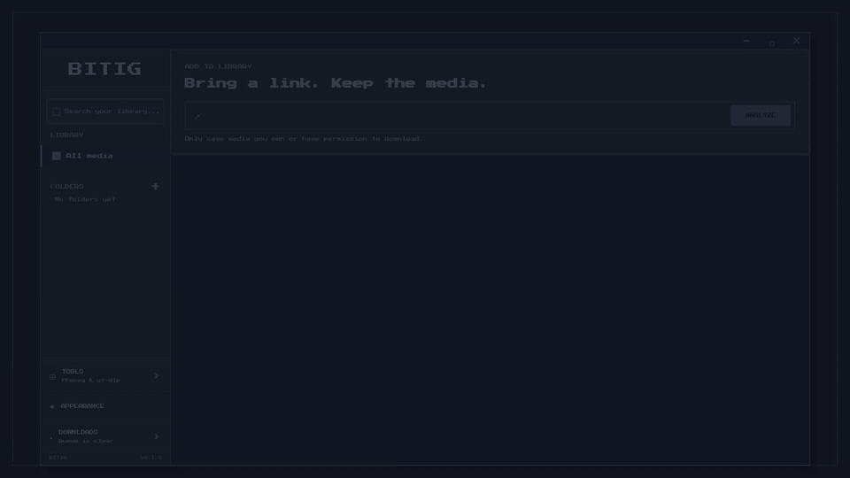

# BITIG

**Save it. Sort it. Keep it.**

BITIG is a local-first Windows desktop media downloader and organized media library. Paste a supported media URL, analyze the available video and audio formats, choose what to save, follow the download, then play and organize the result in nested virtual folders.

Built with Tauri 2, Rust, React, TypeScript, and SQLite. Downloads are managed and verified before they enter the library.

**Supported platform:** Windows x64 · [Get the latest release](https://github.com/oguzhanozen/BITIG/releases/latest)

## See BITIG in action



The 15-second looping preview follows the app's flow: paste a link → analyze → choose video or audio → start a download → watch its progress → find the saved media in the library and folders. 

## Legal / acceptable use

BITIG should only be used for content you have the right to download, copy, or store. Users are responsible for complying with applicable copyright law and terms of service. BITIG is not designed to bypass DRM or access controls.

## Prerequisites

- Node.js 24+ and npm 11+
- Rust 1.94+ with the platform prerequisites required by Tauri 2
- Development sidecars available through `PATH`, the environment variables described in `docs/development/sidecars.md`, or `npm run sidecars:fetch`

End users do not need to install Python, yt-dlp, FFmpeg, or ffprobe separately.
The release configuration builds a Windows x64 Online Installer with required
media tools obtained during setup. Previously published bundled installers
retain their original behavior.

## Installation and media tools

The Windows Online Installer does not embed media tools in setup.exe.
Setup requires interactive acceptance of the terms; silent and passive modes
are rejected. yt-dlp and FFmpeg + ffprobe are required, selected components
that cannot be deselected. The headless bootstrap reuses existing verified
BITIG-managed tools without network requests, or downloads yt-dlp and the
GyanD FFmpeg essentials build (including ffprobe) from GitHub over HTTPS with
SHA-256 verification. It does not use independent tools from system PATH or
legacy packaged tools beside BITIG. Setup stops if required tools cannot be
verified. Tool preparation runs before WebView2 setup and replacement of an
existing application, and the installer preference is saved only at the end
of successful installation.

Automatic media tool updates (T3.5) are optional and off by default. They can
be enabled or disabled in About & Tools, independently of installer terms
acceptance. An existing saved application choice takes priority over the
installer preference. Manual checks and installation remain available; a
restart is required to use newly installed tools. This does not update the
BITIG application itself. The [installer terms and notices](licenses/INSTALLER-TERMS.txt)
document setup behavior, license information, and local data/network
connections. Release remains blocked by the document's distributor placeholder
and the licensing/source-access requirements described below.

## Development

```text
npm install
npm run tauri dev
```

Frontend-only development is available with `npm run dev`, although Tauri commands require the desktop shell.

## Release build

Run `npm run tauri:build` to build the Windows x64 NSIS Online Installer.
It verifies reference provenance and notices without requiring local media
binaries, then checks the actual package with 7-Zip. Package inspection requires
`7z.exe` on PATH or `BITIG_7ZIP_PATH`. Media executables are excluded from the
installer through an empty `bundle.externalBin`; `npm run sidecars:fetch` and
the default `npm run sidecars:verify` remain available for pinned development
binaries. See `docs/development/sidecars.md` for package and publication gates.

Windows release installers are currently published without Authenticode code signing. Windows SmartScreen may therefore show a warning for newly downloaded installers. Release artifacts and corresponding-source archives remain protected by the published SHA-256 checksum file.

## Quality checks

```text
npm run typecheck
npm run lint
npm run test
npm run build
cargo fmt --manifest-path src-tauri/Cargo.toml --all -- --check
cargo clippy --manifest-path src-tauri/Cargo.toml --all-targets -- -D warnings
cargo test --manifest-path src-tauri/Cargo.toml --all-targets
```

## Local data

Tauri resolves the OS-specific AppLocalData directory. BITIG creates `library.db`, `media/`, `thumbnails/`, `temp/`, `tools/`, and `logs/` below that root. Bootstrap stores its update preference in `installer-preferences.json`; UI preferences use WebView2 localStorage. Managed tools use `tools/install-<UUIDv7>/manifest.json` to record versions and binary SHA-256 values. Physical deletion of old tool installations is disabled for process safety, so disk use can grow over time. UI folders are SQLite records; moving or renaming media does not rename the internal media file.

Media URLs and metadata may be stored locally. Sensitive URL parameter filtering
does not guarantee removal of all personal information. Saved library features
work offline; online media operations contact media services, while necessary
tool provisioning and manual or authorized automatic tool updates contact
GitHub. See Part III of the installer document for the informational disclosure.

## Font and licensing

BITIG source code is released under the MIT License; see `LICENSE`.

Press Start 2P is bundled under `src/assets/fonts/` so the desktop UI works offline. Its SIL Open Font License is stored in `licenses/PressStart2P-OFL.txt`. The font asset and license are sourced from the official Google Fonts repository.

yt-dlp 2026.08.19 and the GyanD FFmpeg 9.0.1 essentials build are the current
development/reference baselines, not guaranteed Online Installer
versions. Their provenance, exact source tags and commits, verified source
archive locations, and hashes remain in the sidecar manifest and
[THIRD-PARTY-SOURCES.md](THIRD-PARTY-SOURCES.md). That document also explains how
to find sources for a downloaded version using its actual release provenance.
After any required restart, About & Tools shows the selected yt-dlp and FFmpeg
build versions; ffprobe comes from the same FFmpeg build. Installed versions
can differ from the baseline and the two tool groups can use different managed
installations.

yt-dlp's core is Unlicense; its Windows PyInstaller executable is a GPLv3+
combined distribution. The inspected GyanD FFmpeg/ffprobe build is GPLv3+;
GyanD supplies Windows binaries and is separate from the FFmpeg development
project. These tools run as separate subprocesses. This technical separation
and online downloading do not remove applicable licensing duties.

Complete license texts, yt-dlp notices, FFmpeg source/build information,
Rust dependency notices, Node/React notices, and the font license are preserved
under `licenses/`. The release resource mapping includes that directory,
maps `LICENSE` to `licenses/BITIG-MIT.txt`, and maps the source index to
`licenses/THIRD-PARTY-SOURCES.md` under the installation directory. Package
verification checks all eleven license/notice/source documents against their
repository hashes. Readability after installation still requires installer
validation; version-matched notices and corresponding source/build materials
for downloaded tools remain a publication requirement. The current UI has no
source/license links and bootstrap does not collect updated notices.
The [installer document](licenses/INSTALLER-TERMS.txt) preserves MIT
and third-party open-source rights; it does not replace their license texts.

The reference FFmpeg build includes code derived from the Independent JPEG Group. BITIG uses the GyanD binaries unchanged and makes no additions or deletions to that code. The preserved upstream licensing record in `licenses/FFmpeg-UPSTREAM-LICENSE.md` identifies its source revision in its header; version-specific information must also be checked against the actual build's sources.

## Troubleshooting

- Missing release tools require successful Online Installer provisioning; release startup uses only verified BITIG-managed tools. For development binary names and overrides, see `docs/development/sidecars.md`.
- A migration failure is logged by the Rust backend and prevents startup rather than opening a partially migrated library.
- If the frontend builds but desktop startup fails, confirm the Tauri platform prerequisites and WebView runtime for the current OS.
